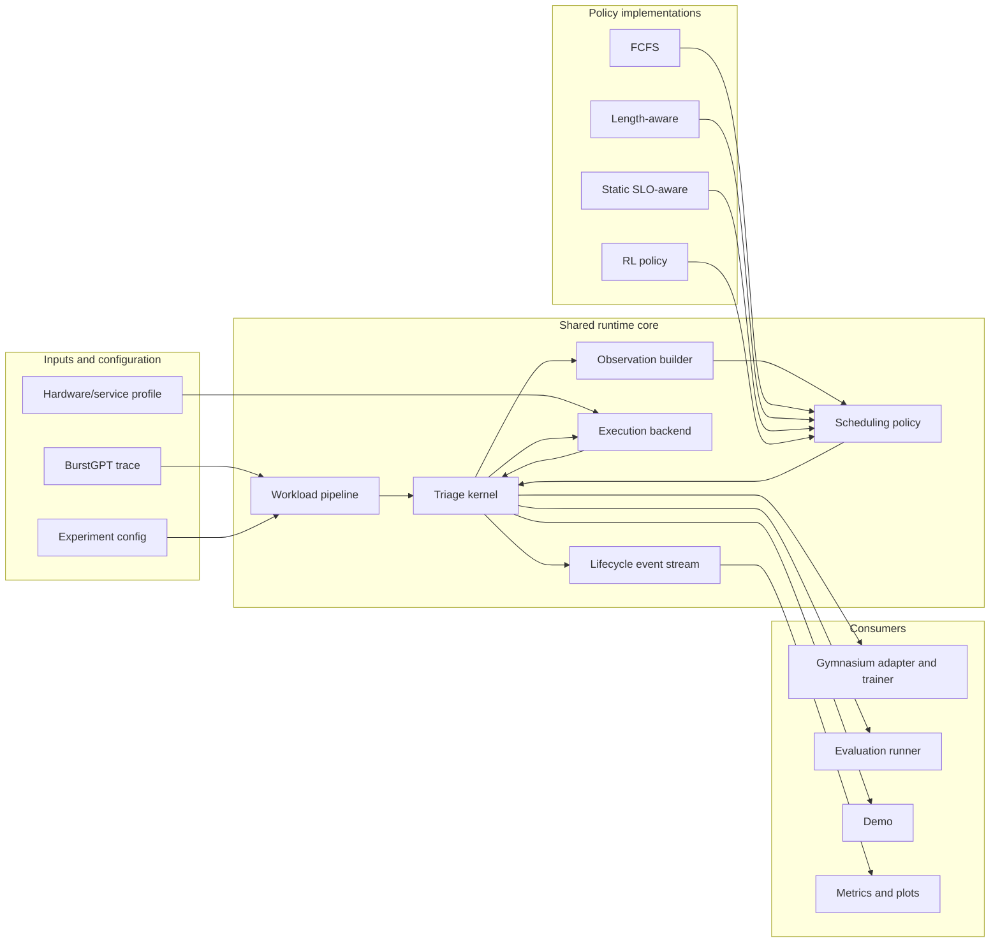
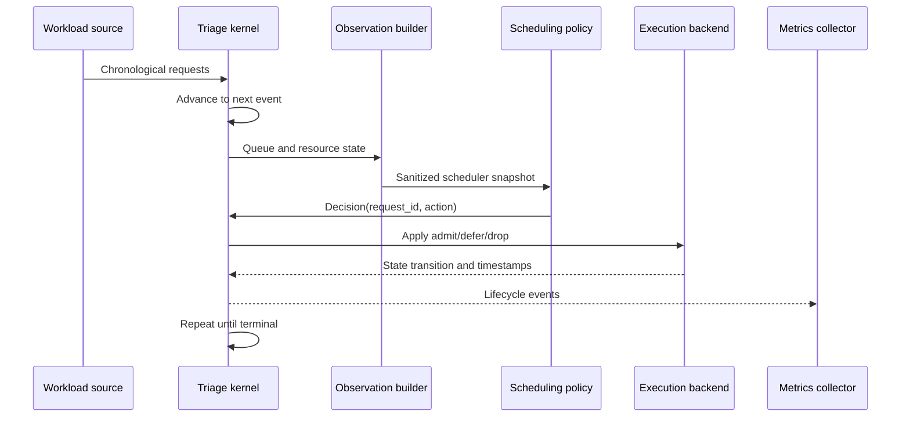

# Technical Design: SLO-Aware LLM Request Triage

**Status:** Living design  
**Last updated:** 2026-11-01  
**Owners:** Hengyi, Xiaofei, Vikas

## 1. Document purpose

This document describes the intended architecture of the complete SLO-aware LLM request-triage project. It establishes stable system boundaries and interfaces while leaving implementation details open to iteration.

The design will evolve as the team validates assumptions. Material decisions should be recorded here or in an architecture decision record (ADR), rather than remaining implicit in notebooks or experiment scripts.

This is not a Week 1 implementation checklist. The weekly milestones in Section 14 describe how the full design is delivered incrementally.

## 2. Problem statement

LLM serving workloads have bursty arrivals and variable prompt and output lengths. Under overload, blindly processing every request can waste compute on requests that will miss their SLOs and can cause queue collapse.

The system will evaluate whether a learned triage policy can improve SLO attainment under workload shifts by choosing among three actions:

- **Admit:** begin service for a selected request.
- **Defer:** postpone the decision while allowing time and workload state to advance.
- **Drop:** reject a request predicted to be unlikely to meet its SLO.

The learned policy will be compared with deterministic scheduling baselines on identical workloads and hardware models. The evaluation must detect degenerate policies that inflate SLO attainment by dropping excessive work.

## 3. Goals and non-goals

### 3.1 Goals

- Replay BurstGPT-derived workloads with reproducible timing and request attributes.
- Model the request lifecycle, including queueing, prefill, first token, decode, completion, and drop.
- Support FCFS, length-aware, static SLO-aware, and learned triage policies through shared interfaces.
- Prevent true output-length leakage into policy observations.
- Train a PPO or DQN policy through a Gymnasium-compatible environment.
- Evaluate policies under normal traffic and distribution shifts such as 3x bursts.
- Report TTFT, SLO attainment, latency tails, throughput, goodput, drop rate, and scheduling overhead.
- Run locally and in Colab from configuration-driven commands.
- Reuse the same implementation in experiments and the final demo.
- Preserve enough configuration and provenance to reproduce reported results.

### 3.2 Non-goals for the initial system

- Reimplementing a production LLM serving engine.
- Perfectly modeling every GPU kernel or network effect.
- Using hidden trace truth as a policy feature.
- Optimizing for multi-node or multi-GPU deployment before the single-resource model is validated.
- Treating notebooks as the authoritative implementation.

Small-scale validation against a real backend such as vLLM and conversation-aware prioritization are stretch goals supported by, but not required for, the core architecture.

## 4. Design principles

1. **One shared implementation.** Code under `src/` is authoritative. Experiments, notebooks, and the demo call it.
2. **Separate truth from observation.** The environment may know realized output length; the policy sees only features available at decision time.
3. **Share the transition model.** Baselines and RL use the same request-state transition kernel to avoid evaluation drift.
4. **Compose policy behavior.** Candidate selection and triage action are separate concepts that can be combined and ablated.
5. **Make metrics hard to game.** SLO attainment includes all arrivals, while throughput, goodput, and drop rate are reported together.
6. **Prefer deterministic, configuration-driven runs.** Seeds and resolved settings are saved with results.
7. **Keep backends replaceable.** The simulator is the primary backend; a real serving backend can be added without changing policy or metrics contracts.
8. **Evolve behind stable interfaces.** Timing models, reward functions, and agents may change without rewriting the workload and evaluation layers.

## 5. High-level architecture



### 5.1 Runtime decision loop



## 6. Component design

### 6.1 Configuration system

The configuration layer loads YAML files, validates values, resolves defaults, and returns immutable typed configuration objects. It covers:

- workload source and chronological window;
- deadline/SLO construction;
- simulator and hardware profile;
- output-length estimator;
- scheduler composition;
- RL algorithm and reward weights;
- evaluation seeds and traffic shifts; and
- output locations.

Every run saves its resolved configuration. Runtime code receives typed configuration objects rather than reading global environment variables.

### 6.2 Workload pipeline

The workload pipeline downloads or locates BurstGPT data, records its provenance, parses the source schema, validates values, aligns timestamps, and produces canonical `Request` objects in chronological order.

Responsibilities:

- preserve raw trace truth for the environment;
- derive deadlines using an explicitly configured rule;
- create deterministic train, validation, and evaluation windows;
- apply traffic transformations such as a 3x burst without mutating the source file; and
- provide small synthetic workloads for tests and demos.

The workload layer does not make scheduling decisions or calculate final metrics.

### 6.3 Service modeling

Service modeling is split into two interfaces:

- **Service-time model:** environment-only model of realized prefill and decode timing using true request outcomes.
- **Service estimator:** policy-visible estimate based only on information available at decision time.

This separation prevents a scheduler from indirectly recovering true output length through a shared timing API.

The first implementation may use linear token rates. A calibrated profile can later replace it with fitted timing functions. Profiles must include the hardware, model, software stack, measurement method, and units.

### 6.4 Triage kernel

The kernel is the authoritative request-state machine. It owns:

- simulated time;
- the arrival cursor and active queue;
- resource and KV-cache state;
- request lifecycle transitions;
- bounded defer behavior;
- prefill/decode phase transitions;
- terminal conditions; and
- lifecycle event emission.

Both deterministic baseline evaluation and the Gymnasium environment call this kernel. The Gymnasium wrapper must not implement a second version of request transitions.

### 6.5 Observation builder

The observation builder converts internal kernel state into a sanitized, policy-visible snapshot. It may expose:

- current time or normalized episode progress;
- visible candidate request features;
- estimated service time and slack;
- queue length and age statistics;
- active batch size;
- KV-cache availability;
- prefill/decode utilization; and
- bounded recent-history summaries.

It must never expose true output lengths, future arrivals, future service outcomes, or metrics calculated using future information. Leakage tests enforce this boundary.

### 6.6 Scheduling policy

A scheduling policy has two conceptual responsibilities:

1. **Candidate selection:** choose which eligible request to consider.
2. **Triage action:** admit, defer, or drop that request.

They can be implemented separately and composed into a scheduler. This supports clear ablations such as FCFS selection plus learned triage versus length-aware selection plus a static rule.

Initial policy compositions:

| Policy | Candidate selection | Triage rule |
|---|---|---|
| FCFS | Earliest arrival | Admit when feasible |
| Length-aware | Shortest estimated service | Admit when feasible |
| Static SLO-aware | Smallest estimated slack | Drop negative-slack work; otherwise admit |
| RL triage | Configured selector or learned selection | Learned Admit/Defer/Drop action |

The canonical RL action semantics must be fixed before final training so comparisons grant policies comparable control.

### 6.7 RL environment and training

The Gymnasium adapter presents the kernel as an episodic environment:

- `reset()` initializes a workload window and returns an observation plus metadata.
- `step(action)` validates the action, applies one kernel transition, and returns the next observation, reward, termination flags, and diagnostic information.
- An action mask marks invalid actions without leaking future state.

Reward shaping is implemented as a replaceable component. The initial asymmetric reward includes:

- positive reward for on-time completion;
- a strong penalty for late completion and wasted service;
- a smaller penalty for proactive drops;
- a bounded cost for defer; and
- an episode-level throughput or attainment term that discourages dropping everything.

Training and evaluation use separate workload windows and seeds. Model selection uses validation results only; final evaluation windows remain untouched until the policy and hyperparameters are fixed.

### 6.8 Metrics and event collection

The kernel emits typed lifecycle events such as arrival, decision, service start, first token, completion, and drop. The metrics collector converts them into one final record per request and one summary per run.

Primary metrics:

- TTFT mean and P50/P95/P99;
- completion latency P50/P95/P99;
- overall SLO attainment;
- fixed-window throughput and goodput;
- drop and unfinished rates;
- maximum and time-weighted queue length;
- service time wasted on late requests; and
- scheduler decision overhead.

Dropped and unfinished requests count as SLO failures. Conditional latency metrics are always reported with drop rate and goodput.

### 6.9 Evaluation runner

The evaluation runner executes a policy matrix over shared workloads, hardware profiles, seeds, and traffic scenarios. It is responsible for:

- pairing policies on identical request streams;
- separating warm-up from measurement windows;
- applying normal and shifted traffic scenarios;
- collecting run artifacts;
- aggregating results with uncertainty across seeds; and
- producing tables and plot-ready data.

The runner invokes shared policy, kernel, and metrics code. It contains orchestration, not scheduling logic.

### 6.10 Demo

The demo visualizes a preconfigured or live simulated traffic spike, including queue state, decisions, drops, completions, and policy metrics. It imports shared runtime components and must not use a simplified duplicate simulator.

The first demo may be a CLI or notebook. A lightweight UI can be added once the experiment pipeline is stable.

### 6.11 Optional real-backend adapter

A future adapter may submit bounded workloads to a real LLM backend such as vLLM. It should emit the same lifecycle-event schema as the simulator so the metrics and reporting layers remain unchanged.

Real-backend results must be labeled separately from simulation results and include hardware and software provenance.

## 7. Core interface design

The following interfaces describe semantics, not necessarily final field names.

### 7.1 Environment truth

```python
@dataclass(frozen=True)
class Request:
    request_id: str
    arrival_time_s: float
    input_tokens: int
    true_output_tokens: int
    deadline_s: float
```

`true_output_tokens` is accessible only to the workload, kernel, and execution backend.

### 7.2 Policy-visible state

```python
@dataclass(frozen=True)
class CandidateView:
    request_id: str
    arrival_time_s: float
    input_tokens: int
    estimated_output_tokens: float
    estimated_service_s: float
    deadline_s: float

@dataclass(frozen=True)
class ResourceView:
    active_batch_size: int
    kv_cache_available: float
    prefill_utilization: float
    decode_utilization: float

@dataclass(frozen=True)
class SchedulerSnapshot:
    now_s: float
    candidates: tuple[CandidateView, ...]
    resources: ResourceView
```

### 7.3 Scheduling contracts

```python
class CandidateSelector(Protocol):
    def select(self, snapshot: SchedulerSnapshot) -> str: ...

class TriagePolicy(Protocol):
    def act(
        self,
        candidate: CandidateView,
        snapshot: SchedulerSnapshot,
    ) -> "Action": ...

class Action(str, Enum):
    ADMIT = "admit"
    DEFER = "defer"
    DROP = "drop"

@dataclass(frozen=True)
class Decision:
    request_id: str
    action: Action
```

The orchestration layer may expose a combined `Scheduler.decide(snapshot) -> Decision` convenience interface.

### 7.4 Kernel and environment contracts

```python
class TriageKernel(Protocol):
    def reset(self, requests: Sequence[Request], config: RunConfig) -> None: ...
    def snapshot(self) -> SchedulerSnapshot: ...
    def apply(self, decision: Decision) -> Transition: ...
    def is_terminal(self) -> bool: ...
    def events(self) -> Iterable[LifecycleEvent]: ...

class RewardModel(Protocol):
    def reward(self, transition: Transition) -> float: ...
```

### 7.5 Lifecycle events

```python
class EventType(str, Enum):
    ARRIVAL = "arrival"
    DECISION = "decision"
    SERVICE_START = "service_start"
    FIRST_TOKEN = "first_token"
    COMPLETION = "completion"
    DROP = "drop"
    EPISODE_END = "episode_end"

@dataclass(frozen=True)
class LifecycleEvent:
    event_type: EventType
    request_id: str | None
    timestamp_s: float
    details: Mapping[str, object]
```

Events form the integration boundary for metrics, traces, plots, and the demo.

### 7.6 Run results

```python
@dataclass(frozen=True)
class RunResult:
    request_records: Sequence[RequestRecord]
    summary: Mapping[str, float | int | None]
    resolved_config: Mapping[str, object]
    provenance: Mapping[str, object]
```

## 8. Metric semantics

Let `N` be all requests arriving during the configured measurement window.

```text
TTFT = first_token_time - arrival_time

slo_met = completed and completion_time <= deadline
overall_slo_attainment = count(slo_met) / N

window_throughput_rps =
    completions inside measurement window / measurement_window_seconds

window_goodput_rps =
    on-time completions inside measurement window / measurement_window_seconds

drop_rate = dropped requests / N
unfinished_rate = unfinished requests / N
```

The metrics layer consumes lifecycle timestamps; it does not estimate service timing. The team may add a distinct TTFT SLO, but it must be named separately from completion-deadline attainment.

## 9. Proposed code structure

```text
llm-request-triage/
├── README.md
├── TECH_DESIGN.md
├── pyproject.toml
├── .env.example
├── configs/
│   ├── simulator.yaml
│   ├── baselines.yaml
│   ├── training.yaml
│   ├── evaluation.yaml
│   ├── distribution_shift.yaml
│   └── hardware/
│       └── rtx5070_qwen05b.json
├── src/
│   └── llm_triage/
│       ├── __init__.py
│       ├── config.py
│       ├── types.py
│       ├── workload/
│       │   ├── burstgpt.py
│       │   ├── synthetic.py
│       │   └── transforms.py
│       ├── service/
│       │   ├── model.py
│       │   ├── estimator.py
│       │   └── profiles.py
│       ├── simulation/
│       │   ├── kernel.py
│       │   ├── events.py
│       │   ├── resources.py
│       │   └── backend.py
│       ├── scheduling/
│       │   ├── base.py
│       │   ├── selectors.py
│       │   ├── fcfs.py
│       │   ├── length_aware.py
│       │   └── slo_aware.py
│       ├── rl/
│       │   ├── environment.py
│       │   ├── observation.py
│       │   ├── masking.py
│       │   ├── rewards.py
│       │   └── agents/
│       │       ├── dqn.py
│       │       └── ppo.py
│       ├── metrics/
│       │   ├── collector.py
│       │   ├── summary.py
│       │   └── schemas.py
│       ├── evaluation/
│       │   ├── runner.py
│       │   ├── scenarios.py
│       │   ├── aggregation.py
│       │   └── plotting.py
│       └── backends/
│           └── vllm.py
├── experiments/
│   ├── run_baselines.py
│   ├── train_agent.py
│   ├── evaluate_agent.py
│   └── run_distribution_shift.py
├── demo/
│   ├── app.py
│   └── sample_inputs.json
├── scripts/
│   ├── prepare_burstgpt.py
│   ├── benchmark_gpu.py
│   └── calibrate_service_model.py
├── tests/
│   ├── fixtures/
│   ├── unit/
│   ├── integration/
│   └── smoke/
├── notebooks/
│   ├── colab_train.ipynb
│   └── analysis.ipynb
├── data/
│   └── README.md
├── results/
│   ├── README.md
│   ├── tables/
│   ├── figures/
│   └── runs/
└── docs/
    ├── metrics.md
    ├── experiments.md
    └── decisions/
```

Directories should be added when they contain useful code or documentation; the team does not need to create every empty directory immediately.

## 10. Data and artifact flow

```text
Raw BurstGPT data
  -> validated canonical requests
  -> immutable workload split/window
  -> kernel + policy execution
  -> lifecycle events
  -> per-request records
  -> per-run summaries
  -> cross-seed aggregation
  -> final tables, figures, and demo
```

Artifact policy:

- Raw external data and model checkpoints are ignored by Git.
- Data provenance and download instructions are committed.
- Compact final tables, resolved configs, and report figures may be committed.
- Every reported result identifies workload split, seed, service profile, policy version, and code revision.

## 11. Experiment design

### 11.1 Baselines

- FCFS
- Length-aware scheduling using estimated service time
- Static SLO-aware scheduling using estimated slack
- Optional oracle baselines clearly labeled as using hidden truth

### 11.2 RL comparisons

- RL versus every deterministic baseline on paired workload windows
- Reward and observation ablations
- Candidate-selector ablations if the selector is not learned
- Multiple random seeds with uncertainty reporting

### 11.3 Distribution shifts

- Sudden 3x arrival-rate burst
- Token-length distribution shift
- SLO tightness shift
- Optional service-profile mismatch

### 11.4 Guardrails

- Report drop rate and goodput beside SLO attainment.
- Keep test windows untouched during training and tuning.
- Never use true output length in a non-oracle policy.
- Measure scheduler overhead separately from simulated service time.
- Pair policies on identical request streams.

## 12. Testing and quality strategy

### Unit tests

- Data parsing, validation, and timestamp alignment
- Service model and estimator separation
- Scheduler ordering and deterministic tie-breaking
- Reward calculations and action masks
- Metric calculations from hand-authored event streams
- Configuration validation

### Integration tests

- A tiny trace runs through all deterministic policies.
- The Gymnasium adapter and baseline runner share kernel transitions.
- Policies cannot access true output lengths.
- Runs with the same seed and config are identical.
- Expected artifacts are written with valid schemas.

### Smoke tests

- A short RL training run completes and updates policy weights.
- The demo starts and processes sample input.
- Colab installation, tests, baseline evaluation, and short training commands run successfully.

### Statistical and scientific checks

- Train, validation, and test windows do not overlap.
- Aggregate metrics report sample size and variability.
- Comparisons use paired seeds/windows where possible.
- Failed or incomplete runs remain visible rather than silently disappearing.

## 13. Deployment and execution environments

The project targets:

- local CPU execution for tests and short simulations;
- Colab CPU/GPU execution for training and evaluation;
- an available CUDA machine for calibration or longer training; and
- an optional real-backend environment for stretch-goal validation.

Canonical commands should remain environment-independent:

```bash
pip install -e ".[dev,rl,plots]"
pytest -q
python experiments/run_baselines.py --config configs/baselines.yaml
python experiments/train_agent.py --config configs/training.yaml
python experiments/evaluate_agent.py --config configs/evaluation.yaml
```

Paths are supplied through configuration and are never hard-coded to a contributor's machine.

## 14. Incremental delivery plan

### Week 1: Core infrastructure and baselines

- Establish shared types, configuration, and scheduler contracts.
- Run the simulator on BurstGPT-derived requests.
- Implement FCFS, length-aware, and static SLO-aware policies.
- Implement lifecycle records and baseline metrics.
- Produce the first reproducible baseline comparison.

### Week 2: RL environment and training

- Wrap the shared kernel in a Gymnasium environment.
- Finalize the observation and action spaces.
- Enforce output-length masking.
- Implement asymmetric reward shaping.
- Train an initial PPO or DQN policy and validate that learning occurs.

### Week 3: Evaluation, shifts, and demo

- Freeze train/validation/test protocols.
- Run distribution-shift experiments across multiple seeds.
- Generate final tables and figures.
- Build the demo from shared code.
- Complete reproduction instructions and repository cleanup.

Later sections may gain implementation-level detail as each milestone is reached, but the component boundaries in this document should remain stable unless the team records a deliberate design change.

## 15. Ownership

| Area | Primary owner | Collaborators |
|---|---|---|
| Simulator, resource state, scheduling hook | Vikas | Hengyi, Xiaofei |
| Workload pipeline, FCFS, RL agent | Hengyi | Vikas |
| Metrics, advanced baselines, reward shaping, visualization | Xiaofei | Vikas, Hengyi |
| Shared interfaces and integration | Team-reviewed | All |
| Reproducibility and final repository cleanup | Hengyi | All |

Primary ownership means responsibility for correctness and integration, not a private contributor directory. Shared implementation belongs under `src/`.

## 16. Migration from the current prototype

The code under `contributions/hengyi/` is the initial reference implementation. It should be migrated incrementally while existing tests protect behavior.

| Current file | Target component |
|---|---|
| `triage_sim.py` | Kernel, baseline scheduling, and metric components |
| `rl_env.py` | Gymnasium adapter and reward model |
| `service_profile.py` | Service model and hardware profiles |
| `workloads.py` / `prepare_trace.py` | Workload pipeline and preparation script |
| `dqn.py` | RL agents |
| `train_dqn.py` / `evaluate_dqn.py` | Experiment entry points |
| `plot_results.py` | Evaluation plotting |

Known gaps to resolve during migration:

- request records lack an explicit first-token event;
- the simple callback in `triage_sim.py` sees only the queue head;
- current modules combine responsibilities that the final design separates;
- a canonical package configuration and root-level test command are not yet present.

The original contribution remains intact until equivalent shared modules and tests are available.

## 17. Open design decisions

These decisions should be resolved through small experiments or ADRs:

1. Exact deadline construction for BurstGPT requests.
2. Canonical output-length estimator for non-oracle policies.
3. Completion SLO, TTFT SLO, or a separately reported combination.
4. PPO versus DQN as the primary learned agent.
5. Whether RL controls candidate selection, triage action, or both.
6. Exact KV-cache and batching fidelity required for credible conclusions.
7. Episode window, warm-up, and drain semantics.
8. Canonical hardware/service profile for primary results.
9. Reward weights and the episode-level anti-drop-all term.
10. Minimum number of seeds and confidence-interval method.

## 18. Design evolution process

- Small clarifications may edit this document directly.
- A change to an interface, metric meaning, action space, or experimental protocol requires team review.
- Important choices should be added under `docs/decisions/` as short ADRs containing context, decision, alternatives, and consequences.
- Resolved items are removed from Section 17 and linked to their ADR.
- Experimental findings should update assumptions without embedding result-specific hacks into shared interfaces.

This document describes the intended architecture. Source code and tests become the executable specification as components are implemented.
