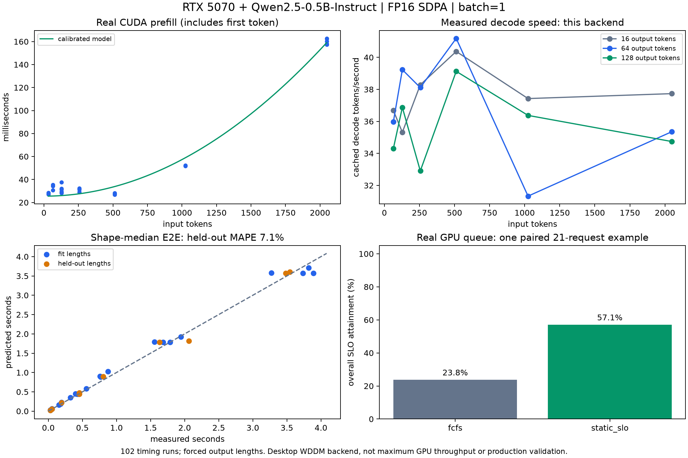

# My Contribution: GPU Calibration and Request-Triage Validation

**Hengyi Yin (@hennyi-yin) — October 28, 2026**
COMS E6998-007: SLO-aware LLM Request Triage

## Summary

I implemented a reproducible triage prototype, connected it to real GPU timing measurements, and ran a small wall-clock queue experiment. This handoff gives the team a usable simulator/RL core, a measured service-time profile, and the evidence needed to review the initial hardware result.

The real GPU queue currently compares FCFS with a static SLO-aware rule. DQN has been trained and evaluated in simulation, including simulation using the measured profile; it has **not** yet been tested as a real-queue policy.

## 1. Work completed

| Component | My implementation |
|---|---|
| Queue simulator | Arrival/start/completion events, FCFS/static rules, deadline metrics, and length-aware/EDF ordering hooks |
| RL environment | Admit/Defer/Drop, seven visible features, explicit time advancement, bounded Defer, and hidden true output lengths |
| RL prototype | NumPy Double-DQN with replay, target network, action masks, Huber loss, and Adam; three initialization seeds; validation-only checkpoint selection |
| Workload pipeline | Pinned BurstGPT acquisition, filtering, chronological partitions, and explicit arrival-rate scaling |
| GPU benchmark | Pinned Qwen model, all-CUDA placement checks, warmup, synchronized prefill/decode timing, raw CSVs and environment records |
| Calibration | Nonnegative timing-model selection and validation on input lengths excluded from fitting |
| Real replay | Wall-clock arrivals and actual model execution for admitted requests in a synchronous CUDA worker |

Exploratory scripts and bulk intermediate outputs stay local. The retained files form a self-contained implementation of this measured-backend contribution.

## 2. Real GPU measurements

Configuration: **RTX 5070 (~12 GB), Qwen2.5-0.5B-Instruct, FP16, SDPA, batch=1**, KV cache enabled, all model parameters on CUDA, no CPU offload. Software: PyTorch 2.9.0+cu130, CUDA runtime 13.0, Transformers 4.57.1, driver 617.42.

I collected **102 timing runs across 34 length combinations**, with three repeats per combination and warmup excluded. Inputs span 32–2,048 tokens; outputs span 1–128 tokens. This is a sampled grid, not every combination. A natural-generation smoke test returned “2 + 2 equals 4.”

Prefill includes selecting the first output token; decode measures **N−1 cached forward steps** for N output tokens. Timing fixes output length by ignoring EOS. Durations are synchronized backend wall time, not pure kernel time or peak GPU performance.

| Input tokens | Output tokens | Median prefill (ms) | Median decode (s) | Sum of stage medians (s) | Old assumed formula (s) |
|---:|---:|---:|---:|---:|---:|
| 128 | 16 | 31.16 | 0.425 | 0.456 | 0.104 |
| 512 | 64 | 27.95 | 1.530 | 1.558 | 0.416 |
| 1,024 | 128 | 52.17 | 3.492 | 3.544 | 0.832 |
| 2,048 | 128 | 162.77 | 3.655 | 3.818 | 1.344 |

The original assumption was `input_tokens/2000 + output_tokens/400`. Its mismatch shows why old assumed-rate results cannot be presented as measured GPU gains. The first 54 timing runs had a median cached-decode rate of **36.69 tokens/s**, specific to this backend.

## 3. Preliminary calibration

Repeats were reduced to a median per length combination. All **128- and 1,024-token input** combinations were held out from fitting and model selection. Leave-one-input-length-out cross-validation on other lengths selected a nonnegative context/quadratic model: 24 fitting and 10 holdout combinations.

| Stage | Held-out MAPE | Held-out P95 absolute percentage error |
|---|---:|---:|
| Prefill | 14.55% | 25.53% |
| Decode | 8.95% | 18.10% |
| End-to-end | **7.06%** | 12.95% |

These errors describe shape medians. Training-length cross-validation error was about 22.7%, so extrapolation remains uncertain. Only 65.21% of selected training requests, versus 99.37% of selected first-round test requests, fall within the measured length bounds.

The [profile](profiles/rtx5070_qwen05b.json) includes coefficients, validation errors, and measurement hashes. Use `ServiceProfile.prefill_s()` and `service_s()`: `prefill_rate=null` means a zero fitted linear term, not infinite throughput. `decode_token_offset=1` preserves the first-token convention.

## 4. Actual GPU queue result

I replayed the same **21 requests** over a 6-second arrival window, with phase rates of 2/6/2 requests per second and a **1-second end-to-end deadline**. Admitted requests executed on CUDA; rejected requests skipped inference.

Inputs were 64/128/256 tokens. Forced outputs were sampled from 8/16/32 tokens and hidden from the scheduler. The static rule used the declared distribution mean of 18.67, not each request's true output length.

| Policy | Arrived | Completed | Dropped | On time | Overall attainment | Completed-request P95 (s) |
|---|---:|---:|---:|---:|---:|---:|
| FCFS | 21 | 21 | 0 | 5 | 23.81% | 5.845 |
| Static SLO triage | 21 | 13 | 8 | 12 | 57.14% | 1.051 |

**Overall attainment = on-time completions / all arrivals; drops count as failures.** Latency includes queue waiting, callback execution, and backend execution, excluding model loading, networking, tokenization, and initial input transfer. P95 is conditional on completion and must be interpreted with rejection rate.

Authoritative records are in [live_queue_checked](results/gpu/live_queue_checked/). This is one workload seed with FCFS run before the static policy: an illustrative example, not statistical proof of a general gain.

## 5. DQN status: measured-profile simulation

I retrained three DQN initializations using this profile and completed **896 policy evaluations**. Checkpoints and static-rule factors were selected using validation data only; each comparison used identical requests and resources.

The DQN column averages three initialization-level workload means. These are simulated overall attainment values, not GPU queue-policy measurements.

| Simulated workload | FCFS | Original static | Validation-tuned static | DQN mean |
|---|---:|---:|---:|---:|
| BurstGPT, 0.6 RPS | 89.48% | 89.36% | 90.11% | 89.75% |
| BurstGPT, 1.2 RPS | 84.52% | 86.38% | 87.30% | 87.00% |
| BurstGPT, 2.4 RPS | 81.98% | 82.89% | 84.11% | 83.90% |
| Synthetic 3x burst | 0.34% | 5.52% | 3.33% | 4.57% |

There is no consistent DQN advantage over reasonable rules. A validation-tuned rule may underperform the untuned rule after a workload shift, so both remain in the comparison. Synthetic outputs often exceed the measured length range and are especially extrapolation-dependent.

## 6. Suggested integration plan

Owners should be assigned together; these are proposed workstreams.

| Priority | Workstream | Completion criterion |
|---|---|---|
| 1 | Repeat real queue tests and randomize policy order | At least 10 predeclared seeds; identical requests per policy; paired intervals; attainment, goodput, drops, and latency reported together |
| 1 | Expand calibration coverage and measure separate sessions | Versioned raw data; untouched validation lengths; repeat variability and out-of-domain coverage reported |
| 2 | Add a frozen DQN callback to the actual CUDA worker | Profile/feature agreement; comparison with FCFS, static and length-aware rules; decision/overhead logs; no current/future output leakage |

Define real wall-clock Defer behavior before the DQN comparison. The simulator waits 0.25 seconds, at most four times per head request. If Defer is disabled in the live experiment, mask it explicitly rather than silently converting it to Admit.

At the meeting, also agree on the primary SLO: retain end-to-end deadlines for the first milestone or define TTFT separately. The current metric is not network TTFT. Freeze workload seeds and data splits before further tuning.

## 7. Review and reproduction

See [README.md](README.md) for CPU-only evidence review, trace preparation, measured-profile training/evaluation, and real GPU commands. The retained evidence includes raw timing CSVs, model/environment provenance, request-level checked replay, the timing profile, compact RL aggregates/configuration, and one figure.

Validation of this curated handoff: **25 unit tests passed**, evidence verification passed, and trace preparation followed by three-seed DQN training and all 896 evaluations completed from this directory. The regenerated aggregate and paired-difference CSVs matched the retained files byte-for-byte. GPU timing CSV hashes were also checked against the exact staged Git bytes.

Full datasets, model weights, virtual environments, learned checkpoints, and exploratory outputs are deliberately excluded. The code can download pinned upstream assets and regenerate dependent results locally.

**Limits:** one small model, a shared Windows WDDM GPU, batch=1, forced output lengths, and no clock/power locking. Larger models, continuous batching, KV-cache pressure, vLLM integration, client-visible TTFT, production P99, and direct real-queue DQN validation remain open.

Sources: [BurstGPT](https://github.com/HPMLL/BurstGPT), [Qwen model card](https://huggingface.co/Qwen/Qwen2.5-0.5B-Instruct), [Double DQN](https://arxiv.org/abs/1509.06461). Numerical evidence is retained in this folder.
